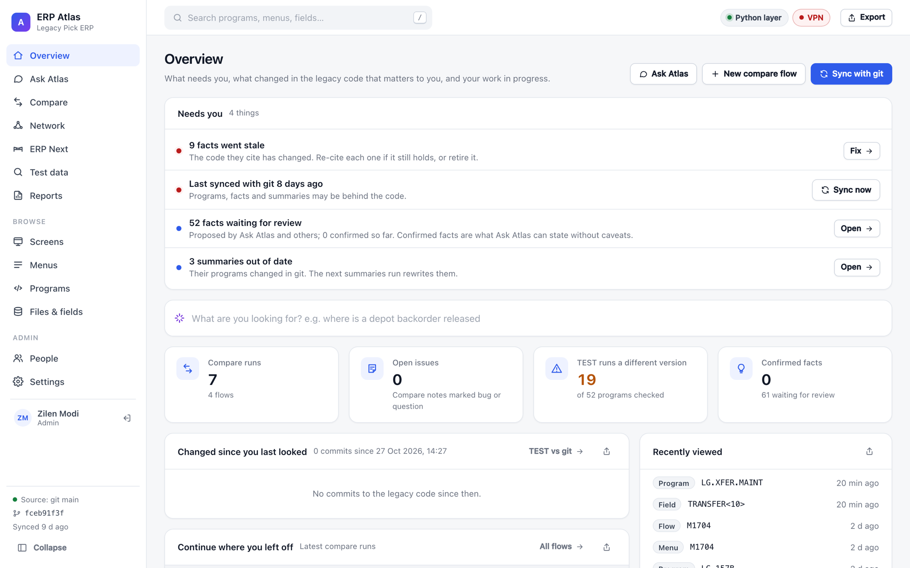
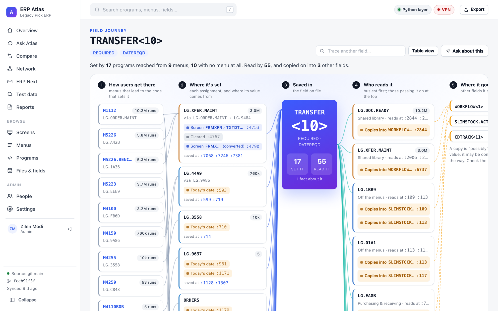
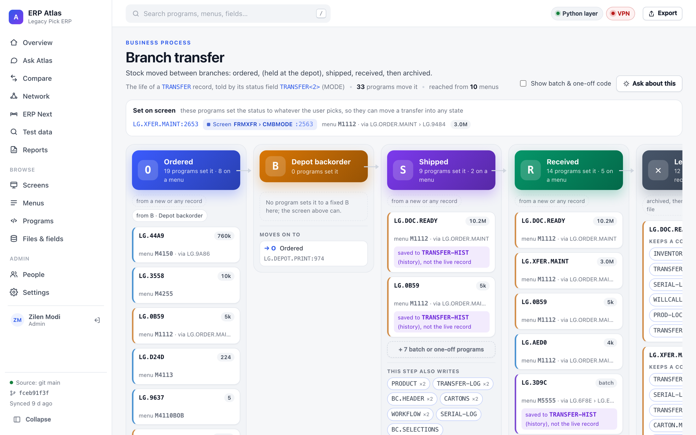
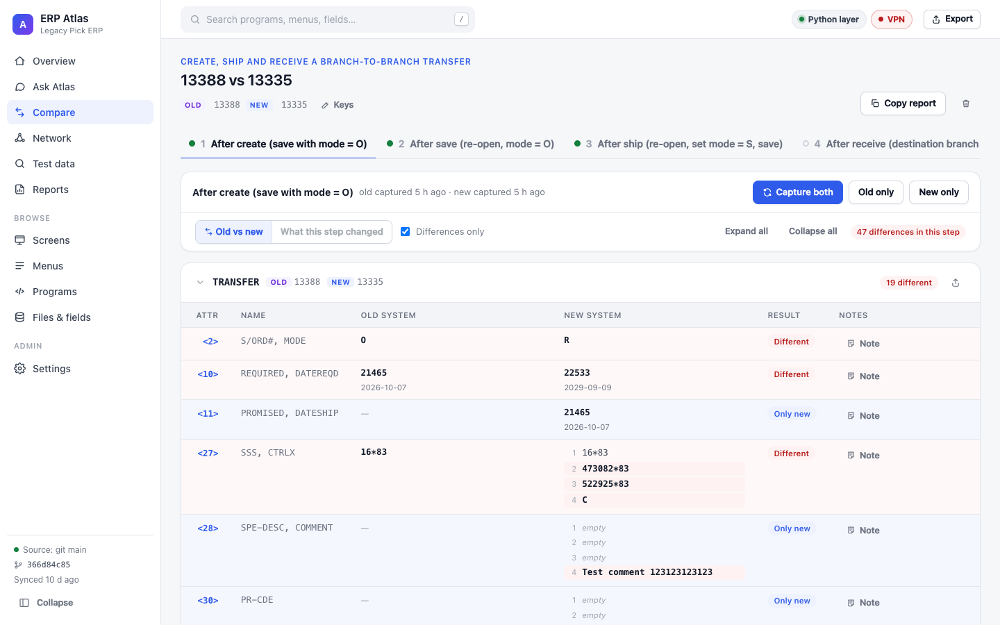

# ERP Atlas

[](https://github.com/zilen-modi/erp-atlas-showcase/actions/workflows/ci.yml)

> **Showcase copy.** Built for a real distribution company's ERP modernisation. Client names are replaced with "Acme", ticket keys with `PROJ-n`, and runtime data (run history, reviews, indexes) is left out. The code, tests and design are unchanged.

**Understand a legacy Pick/UniVerse ERP, and prove its replacement behaves the same.**

Atlas indexes the legacy system's source (programs, procs, menus, screens, dictionaries), reads
real records from a test server, and turns all of it into a web app for a migration team:
search and explain any program or field, compare a flow field by field between the old system and
the new one, find test data, see the screens, profile data quality, map background jobs, and watch
the branch network move.



- **Source of truth:** git `main` of the legacy ERP's repository, kept in Atlas's own mirror and re-indexed incrementally.
- **Live data:** a TEST server, through a small HTTP layer over UniVerse, **read-only**, throttled, with sensitive files blocked.
- **Every answer cites code:** `PROGRAM:line` links open the exact source, and a checker confirms each citation exists and any quoted code matches it.
- **For people and agents:** the same read-only queries power the web app, a CLI and an MCP server.

**At a glance** (one real index): 2.86M lines of BASIC in 9,140 programs, 5,561 dictionaries with
290,257 attributes, 1,157 menus with 86M recorded launches, 2,409 background jobs and 1,822 GUI
screens, joined by 381,231 call edges and 542,572 field references.

---

## Features

### Ask Atlas
Ask in plain English about a flow, a field, a rule or a file. Answers are built from Atlas's
read-only tools (who writes a field, call trees, source lines, dictionary) and cite the code they
rely on. Follow-up questions keep the context; answers stream live, can be stopped, and can be
rated.

Ask runs headless Claude Code with no file or shell access: only Atlas's read-only MCP tools.
Every answer is stored with a citation check (does `PROGRAM:line` exist, does the quoted code match
it), so a wrong reference is flagged, not trusted.

### Field journey
Trace any field, e.g. `TRANSFER<10>` or a DICT name like `REQUIRED`, from end to end: the menus
people start at, every program that sets it and where its value comes from (a screen control,
another file's field, today's date, a calculation, a clear), where the record is saved, who reads
it, and which other fields it is copied into. Every step links to its line.



### Business processes
A record's lifecycle rebuilt from the code that sets its status field. A branch transfer goes
ordered → (depot backorder) → shipped → received → archived. Each step lists the programs that move
it there, the menus they're reached from, what else the step writes, and where the record is saved
or archived. Screens that let a user pick any status are called out separately.



### Facts: knowledge a person confirms
What Atlas has learned about the legacy code, each fact tied to the lines it cites.
- Agents (Ask, or any MCP client) can **propose** a fact. Only a named person can **confirm** one, and names like "agent" or "claude" are refused.
- Every citation stores a hash of its line. If the line moves, the fact is re-pointed automatically. If it changes, the fact goes **stale** and shows the diff, so someone re-cites or retires it.
- Ask states confirmed facts plainly and caveats everything else.

### ERP Next dependencies
The BASIC helpers the new ERP Next API calls, and every old program and Pick file they still
depend on, following calls three levels down. An old program on this page can't be retired until
its logic is rebuilt on the new side.

### TEST vs git
Git `main` is the source of truth. This page shows which programs the TEST server runs a different
version of, classifies every difference (logic, label, comment, whitespace, one side only), and
finds the git commit TEST actually matches and how far behind it is.

### Search by meaning
Program and section summaries are embedded with a local model (`bge-small-en-v1.5` via fastembed),
so "where do we price a kit?" finds code that never uses those words. Nothing leaves the machine,
and summaries are marked stale when their program changes.

### Compare: old system vs new system
Define a **flow** (steps such as *After create → After ship → After receive*, plus the Pick files
it touches), run it with the key of a record made in each system, and capture both sides from
TEST at every step.

- Attribute-by-attribute diff with DICT names, decoded Pick dates and multi-values as numbered lists.
- *What this step changed* view for each side.
- Notes per field (Expected / Bug / Question / Fixed) that carry over to every later run.
- Key patterns per file (`{key}`, `{num}`, `T{num}`, `{key}-1`), with automatic fallback when a file keys the record differently.
- Suggested flows from the code, and a report you can copy or export as PDF.



### Test data
Describe the record you need ("an open transfer to branch 55 ordered this month") and Atlas writes
a read-only RetrieVe selection plus related-record checks (e.g. `TRANSFER-HIST {key}-1` must exist),
runs it on TEST and lists matches. Inside a flow, **Use as old / Use as new** fills the run's keys.
Searches can be saved as scenarios and reused by the team.

### Branch network
A live 3D map of the branch network on real geography: a warehouse per branch at its real town,
the central distribution centre and regional hubs, roads for busy lanes, and a truck for every transfer
in transit (red when it's past its required date). Click a branch, lane or truck for details,
including a transfer's journey and its TRANSFER-LOG history.

### Screens
Every AccuTerm GUI screen in `src/TEMPLATES`, drawn from its definition and wired to the code:
click any control to see the field it reads or writes, its dropdown items or grid columns, and its
event handlers with the files they write. Also flags handlers with no control and buttons with no
handler.

### Programs, menus, files and fields
- **Programs:** callers, calls, files read and written, menu launches, TEST deployment status, source with linkable lines, and call-tree flows.
- **Menus:** every menu ranked by real launches (MENU-ITEMS `#USED`).
- **Files & fields:** a data dictionary per Pick file, who writes and reads each attribute, and the background jobs that change it.

### Data quality
Samples a file's records from TEST and profiles every attribute: fill rate, multi-value use, value
kinds, top values. It flags values that break the DICT (non-numeric quantities, bad dates), attributes
missing from the DICT, stray spaces and control characters, and values that aren't keys in the
files the code looks them up in (e.g. branch numbers not in `BRANCH`).

### Model export
Export any file's dictionary as JSON for the new data model (`pos`, `uv`, `model`, `sm`, `format`).
`sm` and `format` come from the DICT; model names are suggested from the DICT and the code, can be
edited, and the data profile flags where the data disagrees with the DICT. *Export all* downloads a
zip with every file.

### Background jobs
The PROC scripts in `src/PROK`, grouped by when they run (nightly, daily, weekly, month-end,
year-end, on demand): each job's steps in order, the programs it runs, the files and control
counters it changes, the reports it prints, and warnings for commands that clear data. Each job
records its replacement in the new system.

### Reports and export
- **Export** any page, or any single section of a page, as a PDF with a header, page numbers and a shareable link.
- The **Reports** page keeps every export.
- The Overview dashboard collects open Compare issues, recent code changes ranked by usage, data-quality results and recent work.

### Settings and people
Change the data-layer URL (local Docker or a remote server), check the connection, and choose
which sidebar tabs are shown. Accounts are admin or member, with scrypt password hashes, hashed
session cookies, an audit log, and each person's own Claude sign-in stored encrypted. Daily backups
keep the newest 14 copies of the index.

### MCP tools for agents
23 read-only tools, including `search`, `search_code`, `search_meaning`, `program_overview`,
`read_lines`, `callers`, `flow`, `who_writes`, `who_reads`, `field_info`, `trace_field`,
`processes`, `process_flow`, `file_detail`, `menu`, `drift` and `fact_lookup`, plus `fact_propose`.
There is no tool that confirms a fact. TEST reads (`live_record`, `live_examples`) are off unless
the host opts in, and then capped per answer and per person per day, with every read audited.

---

## How it works

```
 legacy ERP repo (GitHub)                          TEST server (UniVerse)
        │ git mirror (.data/erp.git)                      │ python layer: GET /table,
        ▼                                                 │ POST /table/query, /table/block (read-only)
 ┌──────────────┐   parse BP · PROK · MENU · DICT ·  ┌────┴─────────────┐
 │  atlas sync  │──▶ TEMPLATES into SQLite  ◀────────│  live client     │ throttled, parallel,
 └──────────────┘   (.data/atlas.db)                 │  deny-list       │ cached
        │                    │                       └──────────────────┘
        ▼                    ▼
 ┌──────────────────────────────────────────┐      ┌───────────────────────────┐
 │ FastAPI  (atlas serve, 127.0.0.1:8765)   │◀────▶│ Next.js UI (localhost:3217)│
 │ query · compare · finder · profile ·     │      │ /api/* proxied to the API │
 │ screens · network · reports · jobs       │      └───────────────────────────┘
 └──────────────────────────────────────────┘
        │ read-only MCP tools
        ▼
   AI answers (chat, flow and field naming, search criteria)
```

- **Parser:** a flow-insensitive Pick BASIC extractor (built on the repo's `lintbasic` tokenizer) records labels, calls, file handles, reads/writes with keys and attributes, and GUI handlers.
- **Incremental sync:** only files changed since the last indexed commit are re-parsed; directories added later are back-filled automatically.
- **Jobs:** long work (captures, profiles, network refresh, AI naming) runs in the background with live progress and Cancel.

---

## Getting started

### Requirements
- Python 3.11+ with [uv](https://docs.astral.sh/uv/), Node.js 20+, and `gh` signed in (to mirror the legacy ERP repository).
- For live data: the data layer reachable (a local Docker container at `localhost:6000`, usually over a VPN, or a remote URL set in Settings).
- For AI features: the Claude Code CLI installed and signed in on the machine running the API.
- Google Chrome, for PDF export.

### Run

```bash
cp config/policy.example.yaml config/policy.yaml   # then set your repo origin, hosts and organisation name
uv sync
uv run atlas sync                 # first run mirrors the erp repo and builds the index
uv run atlas serve                # API on http://127.0.0.1:8765

cd web
npm install
npm run dev                       # UI on http://localhost:3217
```

Keep the index current with a scheduled sync, for example every 15 minutes:

```cron
*/15 * * * * cd /path/to/erp-atlas && uv run atlas sync >> .data/sync.log 2>&1
```

### Configuration
- `config/policy.yaml` (local, from `policy.example.yaml`): organisation name, environment, data-layer URL, throttle (`min_interval_s`, `parallel`), sensitive tables, git origin and mirror, and the AI model settings.
- `.data/settings.json`: written by the Settings page. It overrides the data-layer URL and records hidden sidebar tabs.
- `ATLAS_API` (web): where the UI finds the API if it isn't `127.0.0.1:8765`.

---

## Safety rules
- **Read-only against TEST.** Only `GET /table`, `POST /table/query` and `POST /table/block` are allowed. The allowlist is hard-coded in `atlas/sources/live.py`, and nothing in config can widen it.
- **Sensitive files are never read:** the `deny_tables` list in the policy (e.g. card and credential files).
- **Selections are checked:** Test data only accepts `WITH …` selection clauses.
- **Your legacy checkout is never touched:** Atlas works from its own mirror.
- **Only aggregates are stored for profiles:** counts and top values, never whole records.
- **AI runs locked down:** no file or shell access, only Atlas's read-only tools.

---

## Project layout

```
atlas/            Python: sync, parsers, query, compare, finder, profile, screens, network, jobs/reports, API, MCP
  trace.py        field journey          process.py   status lifecycles
  knowledge.py    Claude-written summaries   semantic.py  local embeddings
  citecheck.py    verifies PROGRAM:line citations   erpnext.py  ERP Next dependency map
  auth.py         people, sessions, audit    backup.py  daily SQLite backups
  parse/          program, PROC, template and dictionary parsers
  sources/        git mirror and live (python layer) client
  drift/          git vs TEST diff and its classes
  memory/         fact lifecycle, staleness, re-pointing
  mcp/            MCP server
  store/          SQLite schema and access
eval/             golden questions for Ask and the test-data finder
web/              Next.js app (app/ pages, components/, lib/)
  components/network/   3D network scene, models, textures, geography
config/           policy.example.yaml (copy to policy.yaml)
tests/            pytest suite
docs/images/      screenshots used in this README
```

## Development

```bash
uv run pytest            # 119 tests
uv run ruff check .
uv run mypy atlas
cd web && npx tsc --noEmit
```

`atlas/parse/_lintbasic.py` is vendored from the legacy repository's `scripts/lintbasic.py`; re-copy it when the original changes.
`web/components/network/geo.json` is generated by `node web/scripts/build-network-geo.mjs` from US Census boundaries and GeoNames towns.
